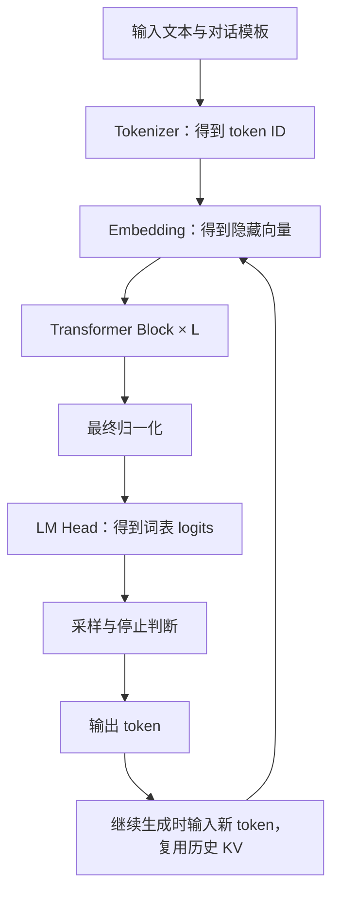
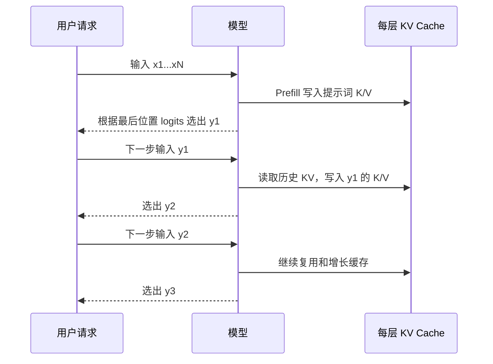

这篇开始一个长期的**基础知识巩固**栏目。我也想借写作把自己对大模型的理解补扎实：看得懂公式，能解释一次推理具体做了什么，再把这些概念与 vLLM、SGLang 和昇腾上的工程问题联系起来。

第一篇先建立完整的计算链路。读完应该能回答：为什么输入要先分词？Attention 到底算什么？模型为什么一层层堆叠？Prefill 和 Decode 有什么不同？KV Cache 存了什么，为什么会吃掉显存？

本文以**常见的 dense、decoder-only、因果 Transformer 文本模型**为主。MoE、滑动窗口、线性注意力、多模态和投机解码有不同的细节，后面会分别展开。文中的尺寸和算例都是教学假设，不是某个真实模型的配置或服务器实测。

系列入口：[基础知识巩固](/blog/llm-foundations/)。建议先看结构，再看推理时间线，最后做文末的小练习，不必一开始记住所有缩写。

## 1. 模型的基本任务：预测下一个 token

对自回归语言模型，最基本的任务是：给定已有 token，预测下一个 token 的概率。

$$
p(x_1,\ldots,x_n)=\prod_{t=1}^{n}p(x_t\mid x_1,\ldots,x_{t-1})
$$

例如输入“北京是中国的”，模型最后输出的不是一句完整回答，而是词表中每个候选 token 的分数。经过采样策略选出一个 token 后，把它加入上下文，再预测下一个。

这并不意味着模型只能做续写。问答、代码、翻译等任务可以通过提示词或对话模板表达成这种序列预测问题。预训练和后训练会影响模型学到的规律与行为，但服务阶段依然需要执行具体的前向计算。

要区分两件事：**参数是训练得到的长期状态，上下文和 KV Cache 是某次请求的运行状态。** 一般推理不会更新权重，但会不断更新请求的缓存。

## 2. Token：模型处理的单位不是“一个汉字”

Tokenizer 把文本映射成 token ID。一个 token 可能是词、子词、字符的一部分，或某种字节序列的表示；具体边界取决于分词器。因此不能固定认为“一个汉字等于一个 token”，也不能拿字符数直接代替模型输入长度。

```text
文本 → Tokenizer → [token ID 0, token ID 1, ...] → 模型
```

对话服务还会添加角色标记、分隔符等模板内容。用户看见的一句话，进入模型的序列可能包含这些额外 token。工具调用、图片编码后的表示等也可能引入额外输入，不能只按可见文字估计长度。

Token ID 是词表中的编号。编号 100 比编号 50 大，并不表示它“语义更强”或“更接近编号 101”。模型要通过 Embedding，把这个离散编号变成可参与数值计算的向量。

## 3. Embedding：查表得到向量，再逐层更新

设词表大小为 `V`，模型隐藏维度为 `d`，Embedding 参数表的形状是：

```text
E: [V, d]
输入 ID: [T]
查表后的 X: [T, d]
```

每个 token 取出一个 `d` 维向量。随着它经过模型，各层会根据上下文更新这个表示。相同 token 的初始查表向量相同，但出现在不同上下文中，后续隐藏状态可以不同。

例如“苹果发布了新产品”和“苹果已经成熟了”中的“苹果”，需要通过上下文被处理成不同的含义。单独查一次词表并不能完成这个区分。

如果包含 batch，常见逻辑形状可以写成 `[B, T, d]`。真实推理框架可能把不同请求的 token 打包成 `[N, d]`，再用元数据区分请求和位置。**逻辑维度与物理内存布局要分开看**，这一点之后理解 KV 缓存很重要。

## 4. 一张结构图：Decoder-only 模型怎么走完前向

原始 Transformer 论文讨论的是 encoder-decoder 结构，不能直接把原论文整张架构图当成所有现代语言模型的结构。下面画的是本文采用的常见 decoder-only 路径。[原始论文](https://arxiv.org/abs/1706.03762)给出了 Attention、残差连接等基础设计；现代模型在归一化、位置编码和 FFN 等部分又有不同选择。



以常见的 **Pre-Norm** block 为例，可以写成：

$$
u=x+\mathrm{Attention}(\mathrm{Norm}(x))
$$

$$
y=u+\mathrm{FFN}(\mathrm{Norm}(u))
$$

其中 Attention 让不同位置之间交换信息，FFN 对每个位置的向量进行变换，残差连接把输入保留下来并加上新的更新。重复 `L` 层后，得到更深的上下文表示。

这是一个常见示意，不是所有模型的精确计算图。实际模型可能有额外归一化、不同残差布局、不同注意力类型或 MoE。读实现时，应以对应模型的源码和配置为准。

## 5. Attention：Q、K、V 分别做什么

对某层的输入 `X`，先做三次线性投影：

$$
Q=XW_Q,\quad K=XW_K,\quad V=XW_V
$$

可以暂时把 `Q` 理解成“当前位置想查询什么”，`K` 理解成“其他位置用于匹配的特征”，`V` 理解成“匹配后实际汇总的内容”。这只是帮助记忆的比喻，三者本质都是训练得到的数值向量，不是人工写好的标签或文本。

对一个 query 位置 `i`，计算它与允许访问的各个 key 的点积，得到分数；经过 softmax 得到权重，再对 value 加权求和：

$$
\mathrm{Attention}(Q,K,V)=\mathrm{softmax}\left(\frac{QK^{\mathsf T}}{\sqrt{d_k}}+M\right)V
$$

`d_k` 是每个 head 的 key/query 维度。除以其平方根有助于控制点积分数的尺度。`M` 是 mask：允许访问的地方加 0，被禁止的位置可以在数学上记为负无穷，使其 softmax 权重为 0。

对于因果注意力，位置 `i` 只能看自己和之前的位置，不能读取后面的 token。即使训练时整段文本都已知，也需要这项限制，否则下一词预测会泄漏答案。

## 6. 用三个位置手算一次注意力

设某个 query 与三个 key 的分数在缩放后为 `[2, 1, 0]`。softmax 后约为：

```text
[0.6652, 0.2447, 0.0900]
```

如果三个 value 向量分别为 `[1, 0]`、`[0, 2]` 和 `[1, 1]`，输出就是：

```text
0.6652 × [1, 0] + 0.2447 × [0, 2] + 0.0900 × [1, 1]
≈ [0.7553, 0.5795]
```

这说明 Attention 通常不是“选中一个位置并复制它”，而是按权重汇总内容。某些分布可能非常尖锐，但不能把这种情况当成一般定义。

如果第三个位置在未来，需要先把第三个分数设为负无穷，再做 softmax，结果约为 `[0.7311, 0.2689, 0]`。**不能先算 softmax 再直接把第三项清零**，否则剩下的权重通常不再加和为 1。

## 7. Multi-Head 与 GQA：为什么 Q 头数和 KV 头数不同

多头注意力把投影后的表示拆成多个 head，各自在其子空间中做注意力，再合并并通过输出投影。它并不保证“一个 head 必然负责语法，另一个负责事实”，这种分工要靠具体分析，不能当成架构定义。

常见的头数关系如下：

| 形式 | Query 头数 `Hq` | KV 头数 `Hkv` | 关系                           |
| ---- | --------------- | ------------- | ------------------------------ |
| MHA  | 多个            | 与 Query 相同 | 每个 Query head 有对应 KV head |
| MQA  | 多个            | 1             | 全部 Query head 共享一组 K/V   |
| GQA  | 多个            | 介于两者之间  | 每组 Query head 共享一组 K/V   |

[GQA 原论文](https://arxiv.org/abs/2305.13245)讨论了这种位于 MHA 与 MQA 之间的设计。对服务系统，一个直接的意义是：缓存按 KV head 保存，因此减少 `Hkv` 可以减少 KV 容量和读缓存的数据量；不能在估算时直接把 Query 头数代进去。

以教学配置 `d=4096、Hq=32、Hkv=8、head_dim=128` 为例，忽略 batch 后：

```text
输入 X:        [T, 4096]
投影后的 Q:    [T, 32 × 128] → [32, T, 128]
投影后的 K/V:  [T,  8 × 128] → [ 8, T, 128]
Attention 输出: [32, T, 128] → [T, 4096]
```

每四个 Query head 共享一个 KV head。实现可以按组进行计算，不必真的把 KV 数据复制成 32 份再存入缓存。不同模型也可能使用不同的 key/value 维度，以上形状只针对这个教学设定。

## 8. 位置、归一化与 FFN：Attention 之外的三个重要部分

### 8.1 为什么需要位置信息

如果没有提供位置信息，仅靠同一套投影和内容匹配，模型很难表达我们需要的顺序关系。因果 mask 限定可见范围，但不能完整替代位置表示。

常见的 RoPE 会按位置旋转 Query 和 Key 的向量分量，使它们的点积携带相对位置信息。这里不展开旋转矩阵，只记住：**位置会影响注意力计算，缓存的 K 必须与正确的位置处理保持一致。** 常见实现把施加 RoPE 后的 K 存入缓存；缓存复用不能随意忽略位置与模型配置。[RoFormer 论文](https://arxiv.org/abs/2104.09864)

### 8.2 Norm 稳定数值尺度，残差保留更新前的信息

以 RMSNorm 为例，对单个 token 的 `d` 维向量做：

$$
\mathrm{RMSNorm}(x)_j=\gamma_j\frac{x_j}{\sqrt{\frac{1}{d}\sum_{k=1}^{d}x_k^2+\epsilon}}
$$

这里的求和发生在隐藏维度上，不是把整条请求或整个 batch 混起来求一个平均。`gamma` 是学习得到的缩放参数，`epsilon` 用于数值稳定。RMSNorm 不做 LayerNorm 那样的减均值；具体模型可能再有其他处理。[RMSNorm 论文](https://arxiv.org/abs/1910.07467)

残差连接中的 `x + 更新量` 则让子层可以在已有表示上修改，而不是每次完全替换。它也有利于训练深层网络，但不能只靠“有残差”就推断任意深度模型都容易训练。

### 8.3 FFN 在每个位置上变换向量

一个普通 FFN 可以先把维度从 `d` 扩到 `d_ff`，经过非线性，再投影回 `d`。常见的 SwiGLU 写法为：

$$
\mathrm{FFN}(x)=\left[\mathrm{SiLU}(xW_g)\odot(xW_u)\right]W_d
$$

其中 `odot` 是逐元素乘法，前两条投影形成门控和内容，最后投回隐藏维度。这里忽略 bias 等模型细节。[GLU 变体论文](https://arxiv.org/abs/2002.05202)

“逐位置”意味着这个 FFN 子层不直接把位置 `i` 与位置 `j` 做交互，但它收到的输入已经由 Attention 融入了上下文。FFN 往往包含大量参数和矩阵乘，分析大模型性能时不能只盯着 Attention。

## 9. LM Head 与采样：向量如何变成输出文字

最后的隐藏向量通过 LM Head，得到词表大小 `V` 的 logits：

```text
最后一个位置的隐藏向量: [d]
输出投影:               [d, V]
logits:                 [V]
```

Logits 是未归一化分数。模型参数中，输入 Embedding 与输出投影可能共享，也可能不共享。后面才是 softmax、采样和停止判断。

| 策略        | 基本含义                                             |
| ----------- | ---------------------------------------------------- |
| Greedy      | 取分数最大的 token                                   |
| Temperature | 正温度下用 `logits / temperature` 调整分布的尖锐程度 |
| Top-k       | 把候选限制在分数最高的 k 个 token 中                 |
| Top-p       | 按概率排序，保留累计概率达到阈值的候选集合           |

常见服务 API 将 `temperature=0` 定义为 greedy，不是直接执行除以零。采样策略改变输出选择，通常没有改变前面的 Transformer 权重或整套前向计算。

选出的 token ID 经过 detokenization 变回文本。一个 token 可能只对应文字的一部分，所以“输出一个 token”不保证界面立刻多出一个完整汉字。流式服务还会涉及缓冲、网络和停止序列处理。

即使使用 greedy，不同硬件、kernel 或数值精度也不保证所有模型都逐 token 相同。Greedy 消除了采样随机性，却没有消除数值误差可能导致的排序变化。

## 10. Prefill 与 Decode：同一套模型，两种工作形态

设提示词有 `N` 个 token，要生成 `G` 个新 token。

**Prefill** 处理已知提示词，计算各层的上下文表示和 KV。因果 mask 限制了每个位置的可见范围，但提示词本身全部已知，因此一层内部可以用并行矩阵运算处理多个位置。不同层之间仍然存在依赖。

提示词最后一个位置的输出给出下一个 token 的 logits，采样得到 `y1`。因此，**第一枚输出 token 通常已经由 Prefill 的前向计算产生**。

接下来进行标准的增量 **Decode**：把 `y1` 作为新输入，复用提示词的 KV，计算 `y1` 自身在各层的 K/V 和隐藏状态，再预测 `y2`。然后输入 `y2`，预测 `y3`，如此循环。



这里用“用户请求”表示生成循环的控制方，不是要求用户手动把每个 token 发回服务器。实际服务会在引擎内部完成循环。

另一个要注意的时间点是：**选出 token，不等于它的 KV 已经存在。** `y1` 刚被选出时，缓存通常只有提示词的 K/V；必须把 `y1` 送入下一次前向，才计算它的 K/V。对标准的一次生成循环，输出 `G` 个 token 的概念路径是一次 Prefill 加 `G−1` 次增量前向；框架内部的记账方式、投机解码或特殊协议可能有所不同。

| 问题                     | Prefill                    | 标准增量 Decode                    |
| ------------------------ | -------------------------- | ---------------------------------- |
| 输入是否已知             | 整段待处理提示词已知       | 当前新 token 已知，后续 token 未知 |
| 单次每个请求处理的位置数 | 可以是多个，也可能分 chunk | 通常一个新位置                     |
| 是否执行所有层           | 是                         | 是                                 |
| 是否更新权重             | 一般推理不更新             | 一般推理不更新                     |
| 对 KV 的作用             | 建立提示词缓存             | 读取历史并追加新位置缓存           |

训练时常用已知真实序列同时构造多个下一词预测目标，也会采用因果 mask；这是 teacher forcing。它与提示词 Prefill 都能利用已知输入的并行性，但训练还需要 loss、反向传播和优化器状态，不能把两者的显存需求直接等同。

## 11. KV Cache：存的是什么，为什么不把 Q 也缓存下来

在标准因果全注意力中，新位置的 Query 需要与历史位置的 Key 匹配，并汇总历史 Value。历史 token 的 K/V 在其所在层已经算过，在模型、位置和上下文条件不变时可以直接复用。

Query 是当前待计算位置拿来查询历史的。未来位置会生成自己的 Query；一般没有必要保存旧 Query 来帮助它们查询。因此服务中的长期注意力缓存主要保存 K 和 V。

还有一个因果性的关键：旧位置不能看未来位置，追加 token 不会让旧位置突然获得新的可见历史，所以旧位置的表示不需要因追加未来 token 而重算。若换成可双向访问的模型，或改变前缀、位置编码和其他条件，就不能照搬这个理由。

```text
第 ℓ 层缓存：K₁...Kₜ、V₁...Vₜ
新位置：计算 qₜ₊₁、kₜ₊₁、vₜ₊₁
注意力：qₜ₊₁ 查询 K₁...Kₜ₊₁，汇总 V₁...Vₜ₊₁
```

KV Cache 并没有免掉新 token 的 Embedding、Q/K/V 投影、Attention、FFN 和 LM Head。它主要免掉了历史 token 的重复前向计算。Decode 仍然要做所有层，也仍然需要读缓存。

没有 KV Cache 时，为产生下一 token，可以对增长后的整个前缀重新做前向；有缓存时，只计算新位置并复用历史结果。在正确实现和数值误差允许的范围内，两条路径应具有一致语义，后面的练习就会直接检查这一点。

## 12. 手算一次 KV 显存：为什么不能只看模型参数量

对各层参数相同、使用普通全注意力的教学模型，忽略 padding、分配器、量化元数据和并行布局，缓存容量近似为：

$$
\mathrm{KV\ bytes}=2\times L\times B\times T\times H_{kv}\times d_{head}\times s
$$

- `2`：K 和 V 两份。
- `L`：层数；每层有自己的缓存。
- `B`：同时缓存的请求数。
- `T`：每个请求当前缓存的 token 数；请求不等长时应对各长度求和。
- `Hkv`：KV 头数，而不是 Query 头数。
- `d_head`：假设 K/V head 维度相同。
- `s`：每个缓存元素的字节数；BF16 常见为 2 字节。

取 `L=32、B=1、T=8192、Hkv=8、d_head=128、s=2`：

```text
2 × 32 × 1 × 8192 × 8 × 128 × 2
= 1,073,741,824 字节
= 1 GiB
```

这是 KV 的教学估算，不是整个服务的显存。若上下文翻倍，约变为 2 GiB；若并发请求数变为 8 且长度相同，约为 8 GiB；若把 KV 头数从 8 增加到 32，其他条件不变，约为 4 GiB。

再假设模型有 80 亿参数，全部权重每个参数 2 字节，则仅权重约为 160 亿字节，即 16 GB、约 14.90 GiB。完整服务还需要 KV、临时激活、算子 workspace、通信缓冲、图捕获内存等。**“权重能放进卡里”不是“这个上下文和并发配置能运行”的充分条件。**

如果不同层保留不同长度，应该逐层求和。滑动窗口通常只需要一定范围的历史，但真实分配还受 block、额外保留 token 和实现策略影响。MLA、线性注意力或状态空间模型的缓存形态也不同，不能直接套用上面的标准 K/V 公式。

## 13. 为什么 Prefill 与 Decode 的性能常常不同

对长提示词，Prefill 有较多 token 同时参与线性层运算，可以形成较大的矩阵乘，通常更容易利用加速器计算能力。全注意力的 token 对数量随长度平方增长，因此长上下文也会带来显著 Attention 计算与中间数据压力。

小 batch Decode 每步只处理少量新 token，却仍然要访问大量权重，并读取历史 KV；计算量相对数据移动较少时，容易受内存带宽和访存效率限制。上下文增长还会增加每步读取 KV 的量。

这是常见工作形态，不能当成不变定律。增大 batch 可以改善权重复用和矩阵乘形态；很长的上下文、MoE 通信、offload、kernel 实现和硬件差异，都可能改变瓶颈。

可以用一个基本问题判断优化方向：**这一步是在等算术计算，还是在等数据到达？** 需要用 profile、实际 workload 和端到端对照回答，不能仅凭“这个算子更快”就推出服务更快。

## 14. FlashAttention、PagedAttention 与 Prefix Caching：分别在优化哪一层

这些名字经常一起出现，但处理的问题不同。

| 技术           | 主要处理的问题                                           | 不应误解为                   |
| -------------- | -------------------------------------------------------- | ---------------------------- |
| FlashAttention | 用分块与在线 softmax 等方式减少 Attention 的中间数据读写 | 自动把全注意力改成线性复杂度 |
| PagedAttention | 管理和访问以 block 组织的 KV，减少分配浪费并支持灵活共享 | 取消 Attention 计算          |
| Prefix Caching | 在条件一致且前缀匹配时复用已算出的前缀 KV                | 按语义相似度随意复用缓存     |

[FlashAttention](https://arxiv.org/abs/2205.14135)通过 IO-aware 的计算组织避免直接在高带宽显存里保存完整的巨大 attention score 矩阵。全注意力的数学计算量仍随 token 对数量增长；不同数值执行顺序也可能带来浮点差异。

[PagedAttention](https://arxiv.org/abs/2309.06180)把逻辑连续的 KV 序列映射到物理 block。逻辑上位置依次排列，不要求它们都在一整块连续物理内存里；执行时用 block table 找到实际数据。分页减少的是分配约束和浪费，block 内仍可能有尾部未使用空间。

[Prefix Caching](https://docs.vllm.ai/en/latest/features/automatic_prefix_caching/)复用已经算过的共同前缀，可以减少后续请求的重复 Prefill。可复用性还取决于模型、适配器、位置和输入内容等条件；“两句话意思差不多”并不构成可复用依据。它没有自动免掉每个新生成 token 的 Decode 计算。

## 15. Continuous Batching 与 Chunked Prefill：服务系统如何组织工作

一个请求要自回归生成，但多个请求可以在同一个调度步中一起运行。Continuous batching 会在迭代边界让已完成请求退出、让新请求加入，而不是要求一批请求全部结束才接收下一批。

因此，“一个请求一次只 Decode 一个 token”不等于“整张卡一次只能算一个 token”。一个 batch 可以包含很多请求各自的新 token，形成更大的计算工作量。

长 Prefill 若一次占用大量资源，可能影响正在 Decode 的请求。Chunked prefill 把待处理的提示词拆成多个调度 chunk，使服务可以更灵活地分配每步 token 预算。有缓存的后续 chunk 仍需正确访问之前的上下文；拆 chunk 不等于切断语义上下文。

实际调度要在吞吐、首 token 延迟、后续 token 延迟、缓存容量和公平性之间做取舍。不同框架和版本的策略有差异，分析时应检查实际调度器和生效的配置。

## 16. P/D 分离与这次 PR：结构知识怎么落到系统里

P/D 分离把 Prefill 和 Decode 放到不同实例，可以分别配置资源和调度。但 Decode 需要 Prefill 产生的每层缓存，所以必须额外完成 KV 交接。能否改善整体服务，取决于转移成本、网络、模型、负载和调度，不能只看到“分开了”就认定一定更快。

至此，[上一日的 Mooncake 注册修复](/blog/2026/vllm-ascend-mooncake-hybrid-registration/)就能放回完整链路：

```text
Tokenizer → 模型 Prefill → 每层 K/V → 底层内存注册
→ 按层地址与 block/stride 传输 → Decode 读取 KV → 生成
```

缓存的“模型语义”是某层、某位置、某个 head 的 K/V；缓存的“物理实现”则包含 storage、view、地址、stride、block table 与注册范围。

某个层 view 的 `data_ptr()` 可以正确指向该层数据，却不是应该注册的底层 storage 起点。解决内存注册问题，既要让后端访问合法的物理范围，又要保留逻辑层地址，不能把这两种地址混为一谈。

这也是学习基础结构的价值：遇到系统代码里的元数据，不只知道变量叫什么，还能说清它对应模型计算的哪一步。

## 17. 三个常见延迟指标怎么读

| 指标 | 看什么                              | 常见影响因素                            |
| ---- | ----------------------------------- | --------------------------------------- |
| TTFT | 从请求起点到第一个输出 token 的时间 | 排队、分词／模板、Prefill、采样、网络等 |
| TPOT | 后续输出 token 的平均间隔           | Decode 计算、调度、通信与网络等         |
| 吞吐 | 单位时间完成的 token 或请求数量     | batch、请求长度、资源利用率与统计口径   |

对有 `G>1` 个输出 token 的一次请求，若用客户端接收时间计算平均后续 token 间隔，可以写成：

$$
\mathrm{TPOT}=\frac{t_{last}-t_{first}}{G-1}
$$

不同 benchmark 的起止点和统计方法可能不同，实验报告必须说明口径。只有一个输出 token 时，没有可供平均的后续间隔。

还要区分平均值和尾部：吞吐很高，不代表每个请求都能满足延迟目标；平均 TTFT 很低，也可能有少数请求等很久。比较系统时，需要固定或说明输入长度、输出长度、到达率、并发与采样配置。

## 18. 可运行的小练习：验证缓存为什么能复用

下面只实现**一个单头因果 Attention 子层**，不包含训练、RoPE、FFN、多层模型或真实文本生成。它把“整段已知输入一次计算”与“逐位置计算并缓存 KV”进行比较，让缓存复用的依据可直接检查。

需要安装 PyTorch。代码使用 CPU 和 float64，小张量即可运行，不需要模型权重或 GPU/NPU。float64 只是为了让这个教学比较更清楚，不代表真实服务应该用 float64。

```python
import math
import torch

torch.manual_seed(7)
T, d = 6, 4
x = torch.randn(T, d, dtype=torch.float64)
wq = torch.randn(d, d, dtype=torch.float64)
wk = torch.randn(d, d, dtype=torch.float64)
wv = torch.randn(d, d, dtype=torch.float64)

# 一次处理整段已知输入：单头因果 Attention。
q, k, v = x @ wq, x @ wk, x @ wv
scores = q @ k.T / math.sqrt(d)
allowed = torch.ones(T, T, dtype=torch.bool).tril()
scores = scores.masked_fill(~allowed, float('-inf'))
weights = torch.softmax(scores, dim=-1)
full = weights @ v
assert torch.all(weights.triu(1) == 0)

# 每次只计算新位置的 Q/K/V，历史 K/V 直接复用。
k_cache = v_cache = None
outputs = []
for t in range(T):
    new_x = x[t:t + 1]
    new_q = new_x @ wq
    new_k = new_x @ wk
    new_v = new_x @ wv
    k_cache = new_k if k_cache is None else torch.cat([k_cache, new_k])
    v_cache = new_v if v_cache is None else torch.cat([v_cache, new_v])
    scores = new_q @ k_cache.T / math.sqrt(d)
    outputs.append(torch.softmax(scores, dim=-1) @ v_cache)
incremental = torch.cat(outputs)

torch.testing.assert_close(full, incremental, atol=1e-12, rtol=1e-12)
print('whole-sequence vs cached attention: PASS')
print('max absolute error:', (full - incremental).abs().max().item())

kv_bytes = 2 * 32 * 1 * 8192 * 8 * 128 * 2
assert kv_bytes == 1024**3
print('teaching KV cache estimate:', kv_bytes, 'bytes = 1 GiB')
```

这段代码已在 CPU 上运行通过。运行后应看到两项检查通过：因果注意力的完整计算与缓存计算一致，教学配置的 KV 估算等于 1 GiB。浮点误差的具体末位可以随 PyTorch 和硬件环境变化；这里用容差断言，不要求输出误差恰好为零。

可以做两个改动观察结果：第一，去掉完整计算的因果 mask，它就会看到未来 token，与增量路径一般不再一致；第二，在增量路径中删掉一部分历史 K/V，两条路径的上下文不同，结果也一般不再一致。不要通过放宽容差掩盖这两种语义变化。

## 19. 基础知识巩固：先自己回答，再展开答案

1. Token ID 较大，是否意味着它的语义更复杂？
2. 已知完整提示词，为什么 Prefill 仍需要因果 mask？
3. 第一个生成 token 刚选出来时，它自己的 KV 是否已经在缓存里？
4. 有 KV Cache 后，Decode 还要不要执行 FFN 和所有 Transformer 层？
5. 为什么 GQA 的 KV 估算用 KV 头数，而不是 Query 头数？
6. KV 教学配置中的上下文长度和并发都翻倍，缓存容量变为原来的多少倍？
7. 两个提示词意思相似，能否直接复用彼此的 KV？
8. FlashAttention 是否把普通全注意力的计算量变成关于长度的线性复杂度？
9. 为什么权重能装进显存，也可能无法运行指定的并发与上下文？
10. 为什么层的逻辑数据地址正确，内存注册仍可能失败？

<details markdown="1">
<summary>展开参考答案</summary>

1. 不能。ID 是词表编号，模型通过 Embedding 和上下文计算获得表示。
2. 因为各位置的表示需要符合自回归可见性，不能让较早位置读取未来输入；“输入已知”与“允许访问”是两回事。
3. 在标准增量路径中通常还没有。Prefill 已计算提示词的 KV；新选出的 token 要送入下一次前向，才产生它自己的 KV。
4. 仍然需要。缓存免去的是历史 token 的重复前向，不是新 token 的完整计算。
5. 共享的是 K/V。多组 Query 可以访问同一组 KV，不应重复计入物理缓存。
6. 在普通全注意力、其他配置相同的近似公式中是四倍；真实布局还需考虑分块、padding 与并行策略。
7. 不能仅凭语义相似。通常需要精确的可复用前缀及一致的模型、位置和输入条件。
8. 没有。它主要改善 IO 和中间数据组织；全注意力仍需处理随长度平方增长的 token 对。
9. 还需要 KV、临时激活、workspace、通信缓冲等，且缓存随请求长度和并发增加。
10. 层的 tensor 可能是 storage 中间的 view。用于定位数据的地址与底层合法、对齐的注册范围不是同一个概念。

</details>

## 20. 下一次读模型代码时，可以沿着这条路线检查

从配置里的 `hidden_size`、层数、Query/KV 头数和 head 维度开始，找到 Embedding、一个 decoder layer、注意力投影、FFN 和输出 head。先标出每个算子的输入输出形状，再看缓存如何写入和读取。

读推理框架时，沿着“请求进入 → tokenization → 调度 → model forward → KV 更新 → 采样 → 返回”追踪。对看到的每个优化，问它改变的是模型数学、数据布局、算子实现、调度，还是通信。这样再读系统 PR，会更容易分清哪些是语义要求，哪些是工程选择。

后续可以把 Attention 的形状与数值稳定单独展开，再详细推导 KV、GQA 和滑动窗口的缓存需求。本篇先把从文本到输出、从模型到服务的完整链路接起来。

## 参考资料

下列资料用于核对基本定义和具体技术来源；文中的教学算例与小练习不是这些论文的性能实验。

- [Attention Is All You Need](https://arxiv.org/abs/1706.03762)：原始 Transformer 与 scaled dot-product attention。
- [The Llama 3 Herd of Models](https://arxiv.org/abs/2407.21783)：现代 decoder-only 模型的一份完整技术报告。
- [GQA](https://arxiv.org/abs/2305.13245)：Query 组共享 K/V 的设计。
- [RoFormer](https://arxiv.org/abs/2104.09864)：旋转位置编码。
- [Root Mean Square Layer Normalization](https://arxiv.org/abs/1910.07467)：RMSNorm。
- [GLU Variants Improve Transformer](https://arxiv.org/abs/2002.05202)：门控 FFN 变体。
- [FlashAttention](https://arxiv.org/abs/2205.14135)：Attention 的 IO-aware 计算组织。
- [PagedAttention](https://arxiv.org/abs/2309.06180)：LLM serving 的 KV 内存管理。
- [vLLM Automatic Prefix Caching](https://docs.vllm.ai/en/latest/features/automatic_prefix_caching/)：前缀复用的作用与限制。
